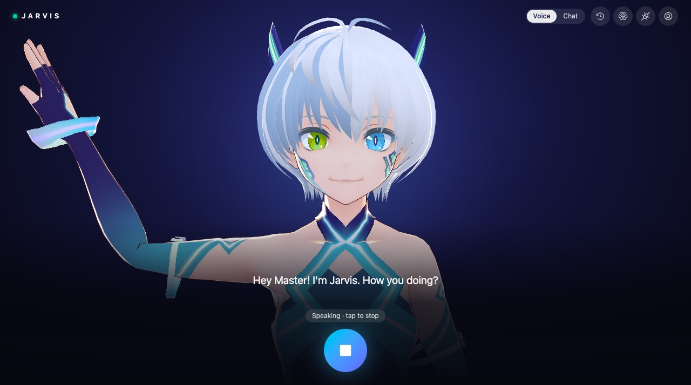
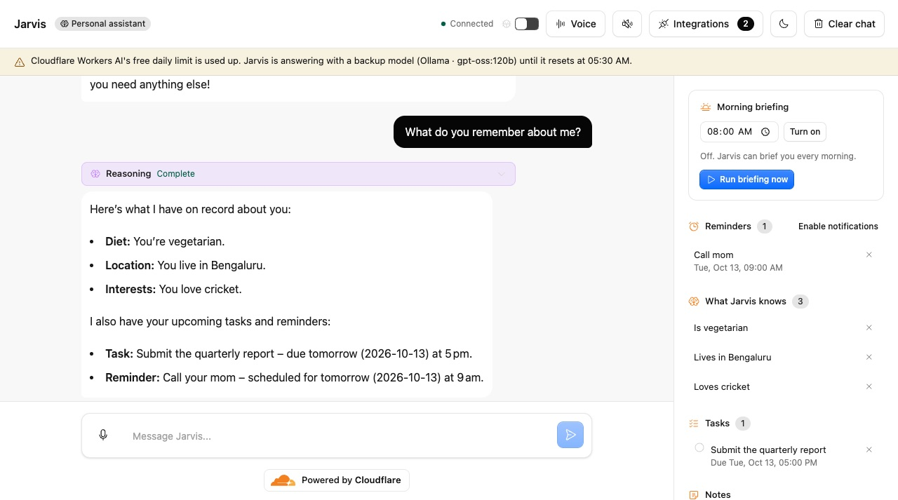
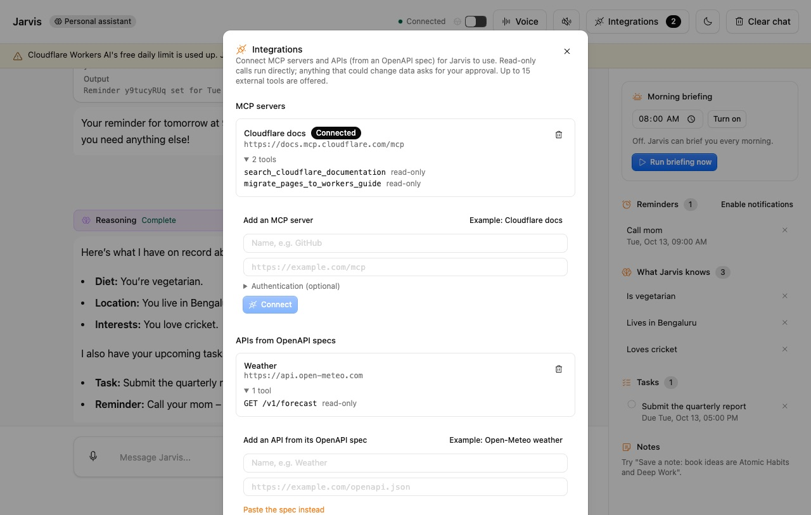
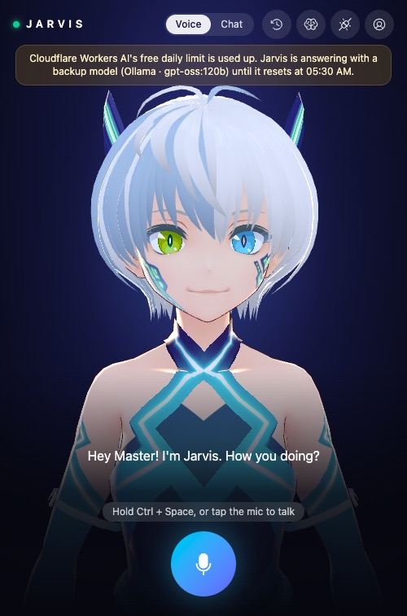
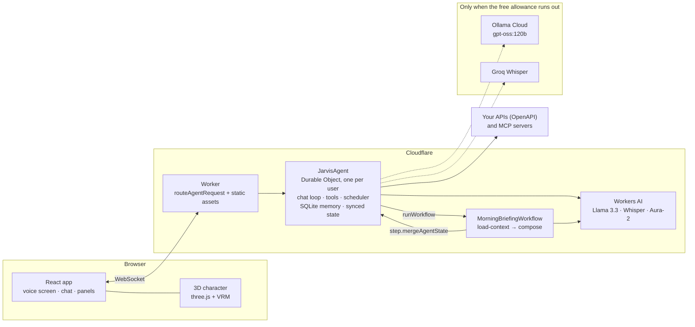

# Jarvis

A personal AI assistant that runs on Cloudflare. You talk to an animated 3D character (or chat, if you prefer). It remembers what you tell it, keeps your tasks and notes, briefs you every morning, reminds you of things out loud, and can use outside APIs and MCP servers you connect.

**Live:** https://jarvis.hiteacher.workers.dev



| Chat mode, with memory, tasks and reminders | Connected APIs and MCP servers                     | On a phone                                                   |
| ------------------------------------------- | -------------------------------------------------- | ------------------------------------------------------------ |
|      |  |  |

## What it does

- **Talk or type.** The main screen is a 3D character: hold **Ctrl+Space** (or tap the mic), speak, let go. It answers out loud, with its mouth moving to the audio and its expression changing while it listens, thinks and speaks. Chat mode shows the same conversation as text.
- **Remembers you.** Tell it "I'm vegetarian" or "my sister is Priya" and it saves the fact in the background. It also keeps tasks and notes. Forgetting something needs your approval.
- **Acts on its own.** A daily morning briefing runs as a durable Workflow at the time you choose. Reminders fire on schedule, and Jarvis announces them.
- **Uses your tools.** Paste an OpenAPI spec and each operation becomes a tool Jarvis can call, or connect any MCP server. Read-only calls run directly; anything that could change data asks you first.
- **Keeps working when the free tier runs out.** Llama 3.3 on Workers AI is the main model. When the daily free allowance is used up, it falls back to Ollama Cloud for chat, Groq for transcription, and your browser for speech, and a banner tells you so.

## How it meets the assignment

| Requirement                 | How Jarvis does it                                                                                                                                                                  |
| --------------------------- | ----------------------------------------------------------------------------------------------------------------------------------------------------------------------------------- |
| **LLM**                     | Llama 3.3 70B on Workers AI (`@cf/meta/llama-3.3-70b-instruct-fp8-fast`), with tool calling. Whisper and Deepgram Aura-2 on Workers AI handle speech.                               |
| **Workflow / coordination** | One Agents SDK agent (a Durable Object) per user coordinates chat, tools, schedules and memory. The morning briefing is a Cloudflare Workflow (`AgentWorkflow`) with retried steps. |
| **Chat or voice input**     | Both: a voice screen with push-to-talk and spoken replies, and a chat view, over one WebSocket and one shared history.                                                              |
| **Memory or state**         | Each agent's own SQLite holds facts, tasks, notes and connected APIs. Synced agent state pushes the briefing, reminders and limits to every open tab.                               |

## Architecture



**A spoken turn, end to end:**

1. You hold Ctrl+Space. The browser records, converts the clip to 16 kHz WAV, and sends it to the agent.
2. The agent transcribes it with Whisper (or Groq), and the text is sent as your message.
3. The agent builds a prompt from its memory, within Llama 3.3's 24K-token context, and runs the model with your tools.
4. Tool calls run against the agent's SQLite, its scheduler, or your connected APIs. Anything destructive waits for your approval.
5. The reply streams back. The browser speaks it with Aura-2 (or its own voice) while the character's mouth follows the audio.
6. After the turn, a background job extracts any new facts about you into memory.

The design doc with the original plan is in [`Jarvis — Architecture on Cloudflare.docx`](./Jarvis%20%E2%80%94%20Architecture%20on%20Cloudflare.docx).

## Run it locally

You need Node 20 or later and a Cloudflare account. Workers AI runs on Cloudflare even in local development, so you have to log in.

```bash
npm install
npx wrangler login
cp .dev.vars.example .dev.vars   # optional: backup keys, see below
npm run dev                      # http://localhost:5173
```

The backup keys are optional. Without them, Jarvis simply stops answering while the Workers AI free allowance is used up.

| Variable         | What it's for                                                    |
| ---------------- | ---------------------------------------------------------------- |
| `OLLAMA_API_KEY` | Ollama Cloud fallback for chat, fact extraction and the briefing |
| `GROQ_API_KEY`   | Groq Whisper fallback for voice input                            |

### Deploy

```bash
npm run deploy
npx wrangler secret put OLLAMA_API_KEY   # optional
npx wrangler secret put GROQ_API_KEY     # optional
```

## Tests

End-to-end smoke tests talk to a running Jarvis over the same WebSocket protocol as the browser, so they exercise the real agent and model. They use a fresh agent each run.

```bash
node scripts/smoke-memory.mjs http://localhost:5173
```

| Script                   | Checks                                                                                                                                                                                     |
| ------------------------ | ------------------------------------------------------------------------------------------------------------------------------------------------------------------------------------------ |
| `smoke-chat.mjs`         | One chat turn, and tool calling                                                                                                                                                            |
| `smoke-memory.mjs`       | Facts extracted in the background, paraphrases not duplicated, tasks and notes, forgetting with approval, memory surviving a cleared chat, no "I'm calling a function" chatter (10 checks) |
| `smoke-briefing.mjs`     | The briefing Workflow end to end, the UTC cron for a local time, unrequested tool calls, reminders set, cancelled and fired (14 checks)                                                    |
| `smoke-voice.mjs`        | Real speech (generated with macOS `say`) transcribed, the spoken-reply fallback, bad audio rejected                                                                                        |
| `smoke-integrations.mjs` | Unsupported specs rejected, an OpenAPI spec converted and called, writes asking for approval, an MCP server connected and used (10 checks)                                                 |

These call the real model, so each full run uses part of the daily Workers AI allowance.

## Project layout

| Path                                                          | What's there                                                                    |
| ------------------------------------------------------------- | ------------------------------------------------------------------------------- |
| `src/server.ts`                                               | The agent: chat loop, tools, memory, scheduling, voice, integrations            |
| `src/briefing-workflow.ts`                                    | The morning briefing Workflow                                                   |
| `src/memory.ts`                                               | Memory types, the system prompt, the context budget, fact extraction            |
| `src/ai-fallback.ts`                                          | Workers AI → Ollama fallback when the daily allowance runs out                  |
| `src/single-format-ai.ts`                                     | Fixes for Workers AI output quirks (doubled tokens, empty tool lists)           |
| `src/tool-talk-filter.ts`                                     | Removes "I don't need to call a function" replies from the stream               |
| `src/openapi-tools.ts`                                        | OpenAPI 3.x → MCP-style tools, and the HTTP shim that calls them                |
| `src/speech-server.ts`                                        | Groq transcription and Aura-2 speech                                            |
| `src/time.ts`                                                 | Timezone conversion (local time → UTC cron, daylight saving)                    |
| `src/app.tsx`                                                 | The React app: voice/chat modes, the shared recorder, Ctrl+Space, announcements |
| `src/voice-screen.tsx`                                        | The voice screen                                                                |
| `src/avatar/`                                                 | The 3D character: scene, expressions, lip-sync, and the character list          |
| `src/voice.ts`, `src/speech-output.ts`, `src/audio-levels.ts` | Recording, playback, and the loudness meters behind lip-sync                    |
| `scripts/`                                                    | Smoke tests                                                                     |

## Design decisions

The main ones are below. Each is explained, with the reasoning, in [PROMPTS.md](./PROMPTS.md#design-decisions-and-trade-offs).

- **One agent per user.** A single writer for each user's data, so no locks, and it scales by adding instances.
- **Fact extraction after the reply**, so the reply is never slowed. The extractor sees the known facts, so paraphrases aren't saved twice.
- **A Workflow for the briefing**, for per-step retries and a visible history of runs.
- **Human approval** for anything destructive, and for any external call that could change data.
- **Cloudflare first, then backups**, with the app saying when it's using one.
- **Working with Llama 3.3's limits**:
  - few tools
  - short IDs the model can copy back
  - the prompt rebuilt before every step
  - a forced text answer after a successful tool call
  - old tool calls removed from history

## Known limitations

- **No sign-in.** Each browser gets a random, unguessable agent ID; clearing site data starts a new Jarvis.
- **Reminders need an open tab.** They're delivered when a tab is open (with a browser notification if allowed). Push delivery isn't built.
- **Daylight saving.** The briefing's cron is fixed in UTC, so in zones with daylight saving it drifts by an hour until it's set again.
- **Backups leave Cloudflare.** Chat sent to Ollama and audio sent to Groq go to those providers. The browser's speech recognition (the last resort) sends audio to Google in Chrome.
- **Integration limits:** OpenAPI 3.x only (not Swagger 2.0), at most 15 external tools, and API keys for connected APIs are stored in the user's agent storage.
- **Mac shortcut clash.** On a Mac with more than one keyboard input source, Ctrl+Space also switches input language.
- **Heavy characters.** Each character is a 15–19 MB download the first time.

## Credits

- Started from Cloudflare's [`agents-starter`](https://github.com/cloudflare/agents-starter) (MIT; see `LICENSE`).
- The 3D characters are VRoid Studio sample models, released under CC0 (see `public/avatars/LICENSE.md`), rendered with [three.js](https://threejs.org) and [`@pixiv/three-vrm`](https://github.com/pixiv/three-vrm).
- The OpenAPI-to-tools mapping follows open-source OpenAPI→MCP converters such as [TykTechnologies/api-to-mcp](https://glama.ai/mcp/servers/@TykTechnologies/api-to-mcp).
- Built with Claude Code as a pair programmer. The full prompt history is in [PROMPTS.md](./PROMPTS.md).
